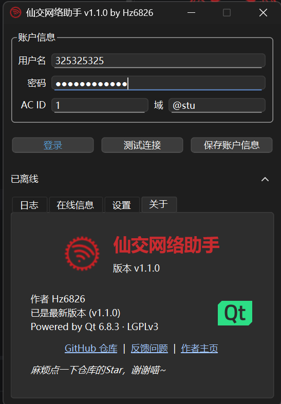

<!--suppress HtmlDeprecatedAttribute -->

# 

### 基于 Qt 的西安交通大学校园网鉴权桌面客户端

## 快速开始

请在 [Releases](https://github.com/Hz6826/XJTUNetLogin/releases) 界面获取最新版本。其中可执行程序为 **Inno Setup** 打包的安装版，名称包含 `Portable` 的压缩包（`XJTUNetLogin-Portable-<版本>.zip`）为便携版。

> [!IMPORTANT]
> 如果要使用开机自启功能，建议使用安装版！

> [!NOTE]
> 两个版本的程序本体相同。便携模式判定：主程序同目录下存在 `config.json` 或 `portable.flag` 时，按便携版运行——读取同目录的 `config.json`，日志写到同目录的 `./logs/` 下。安装版则使用 `%APPDATA%\Hz6826\XJTUNetLogin\config.json`，日志在同目录的 `logs\` 下。

> [!WARNING]
> **安全说明**
> - 配置文件里的密码目前以**明文**保存（安装版在 `%APPDATA%\Hz6826\XJTUNetLogin\config.json`，便携版在主程序同目录）。请勿分享 `config.json`，也尽量不要把便携版放在公共或共享目录中。
> - 日志默认对 `token`、`password`、`chksum` 等敏感字段脱敏。在“关于”页双击应用图标可以关闭脱敏（状态会保存到配置，再次双击恢复）；关闭后日志会包含明文敏感信息，请勿随意分享日志文件。

## 功能列表

- :white_check_mark: 已完成
- :memo: 进行中
- :x: 近期无计划实现

| 功能             | 实现情况               |
|----------------|--------------------|
| 登录/注销          | :white_check_mark: |
| 测试连接           | :white_check_mark: |
| 获取在线信息         | :white_check_mark: |
| 账户存储           | :white_check_mark: |
| 托盘最小化          | :white_check_mark: |
| 开机自启           | :white_check_mark: |
| 自动登录           | :white_check_mark: |
| 自动检查版本         | :white_check_mark: |
| 自定义主题          | :white_check_mark: |
| macOS/Linux 支持 | :memo:             |
| Android 支持     | :memo:             |

## 自定义主题

设置 → 外观 → 主题 可以切换主题。主题放在主题目录下，一个子文件夹即一套主题；可以分别提供浅色/深色样式，跟随系统明暗自动切换，`default` 表示恢复系统原生样式。

- 安装版主题目录：`%APPDATA%\Hz6826\XJTUNetLogin\themes`
- 便携版主题目录：主程序同目录 `themes`
- 内置示例：蓝调（`blue`）、樱花（`sakura`）、赛博（`cyber`）、矩阵（`matrix`），均带明暗两套
- 便携版 zip 与安装包都会附带这些示例主题：便携版在 exe 同目录的 `themes/`，安装版装到上面的 AppData 目录

主题结构、`manifest.json` 字段（主题名/作者/图标线条色/标题栏与边框配色等）以及 QSS 写法见 **[doc/themes.md](doc/themes.md)**。

## 画廊

点击展开画廊

## 原理

本仓库客户端 `SrunClient` 和加密库 `SrunCrypto` 参考了登录门户 JS 的实现，基本流程如下：

### 登录

1. 第一次 `requestChallenge`：向服务器请求一个 challenge token，附带 `username`，此时 `ip` 为空。本次 challenge 丢弃，仅通过响应体获取服务器处的真实内网 IP。
2. 第二次 `requestChallenge`：此时携带步骤 1 中获取的 `ip`，重新获取 challenge token，服务器返回 `token`。
3. `requestAuth`：登录主体，进行主要的加密、签名操作：
   1. `SrunCrypto::hmacMd5`：使用 `HMAC-MD5` 加密，返回 32 位小写 hex 字符串，存入 `password`。
   2. `SrunCrypto::encodeUserInfo`：拼接 JSON，使用 `xxteaEncrypt` 将 JSON 用 `token` 加密，返回的 `{SRBX1}` 存入 `info`。
   3. `SrunCrypto::buildChksum`：将上述参数等拼接后计算 `sha1` 作为校验和。
   4. 请求：携带所有参数向服务器 `/cgi-bin/srun_portal` 发送 `GET` 请求，`action` 为 `login`，并读取响应。
4. `pollOnlineStatus`：若登录成功，确认在线状态，默认 3 次。

### 注销

携带 `action=logout` 与 `username`（用户名与域名后缀拼接，如 `user@stu`），向服务器 `/cgi-bin/srun_portal` 发送 `GET` 请求；当前实现不再携带 `ip`、`ac_id` 等参数。若注销请求被接受，再通过 `pollOnlineStatus` 确认已下线，默认 3 次。

### 查询

直接向服务器 `/cgi-bin/rad_user_info` 发送 `GET` 请求（当前实现不再附带 `username`/`ip`/`ac_id` 等查询参数），服务器返回 JSONP。

## 许可证

本项目使用了依据 [GNU Lesser General Public License v3](https://www.gnu.org/licenses/lgpl-3.0.en.html#license-text) 协议开源的 Qt 库，并遵循该协议的相关条款。

本项目使用 [Inno Setup](https://jrsoftware.org/isinfo.php) 打包，感谢 Jordan Russell 做出的贡献！

本项目基于 [MIT License](LICENSE) 开源。

## 致谢

- [@Ianzb](https://github.com/Ianzb/)：提供了大量宝贵意见。
- [@The-time-forever](https://github.com/The-time-forever)：作为最早的贡献者支持该项目。

### 贡献者

## Star History

_如果觉得这个项目对你有帮助，麻烦点一下右上角的 Star，你的支持是我最大的动力，谢谢喵~_

